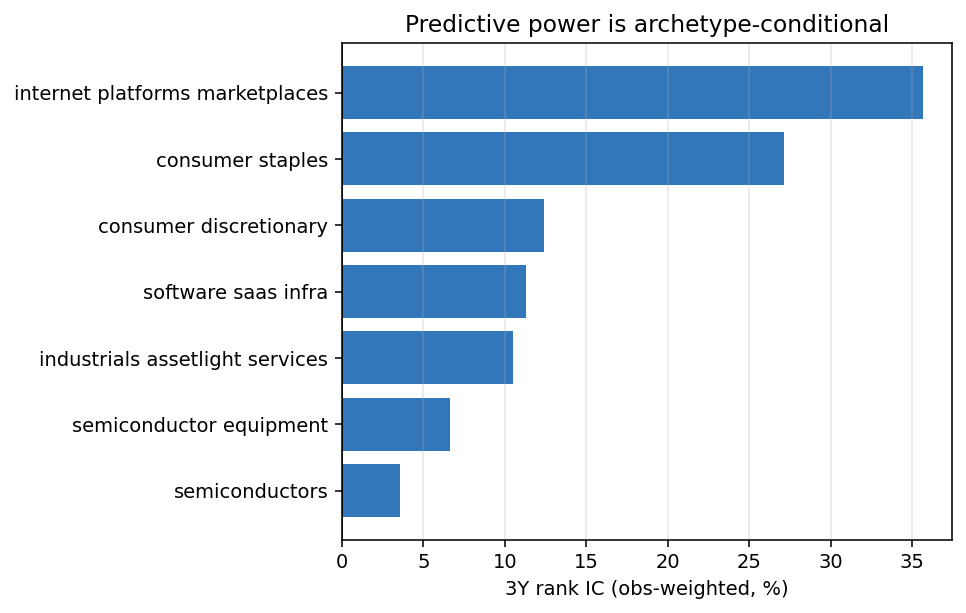
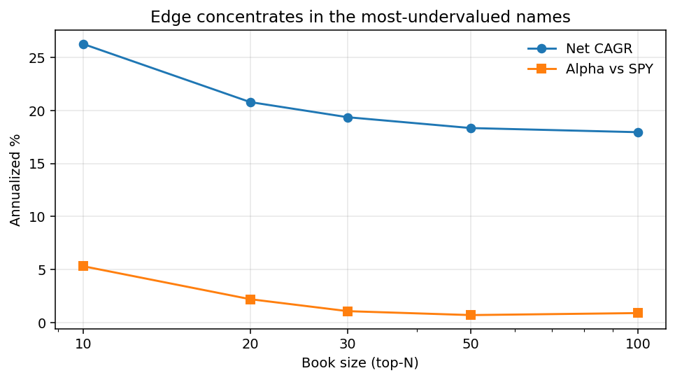
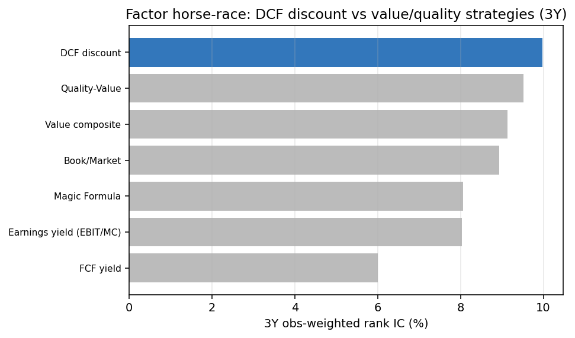
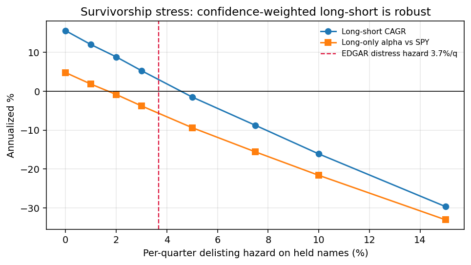
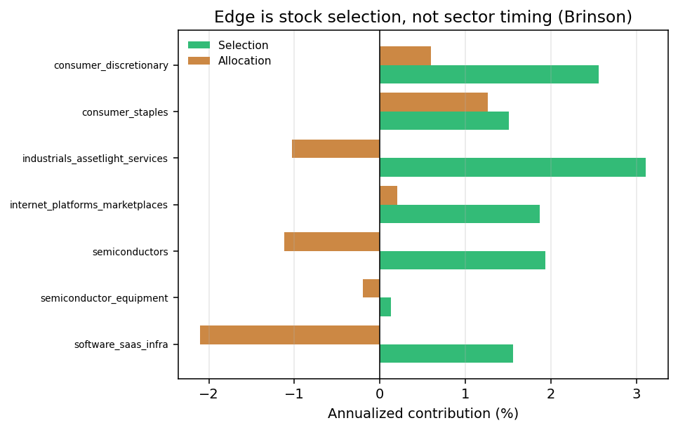
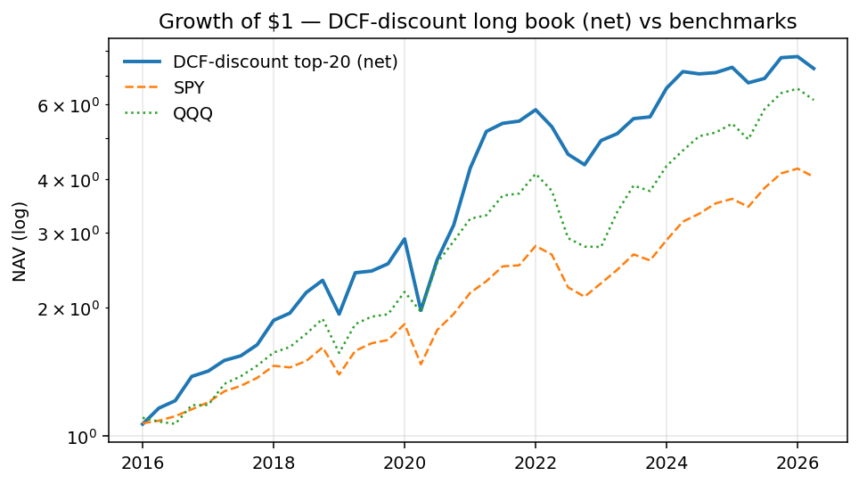
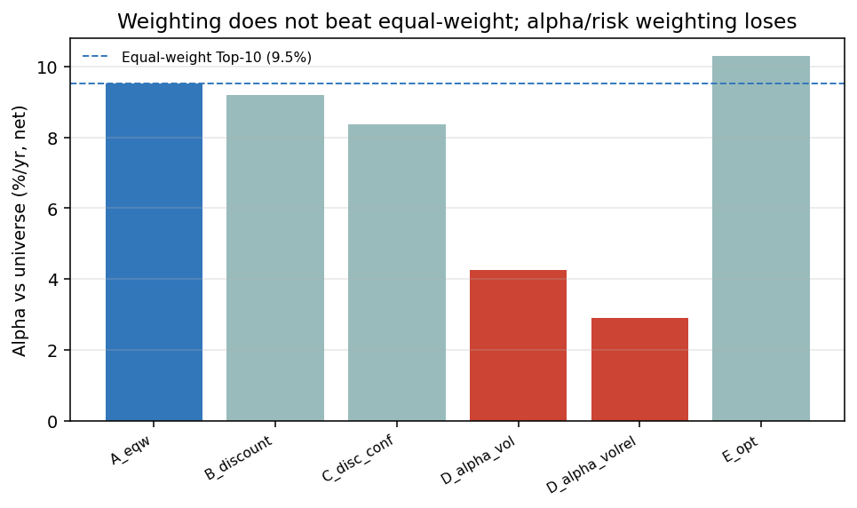
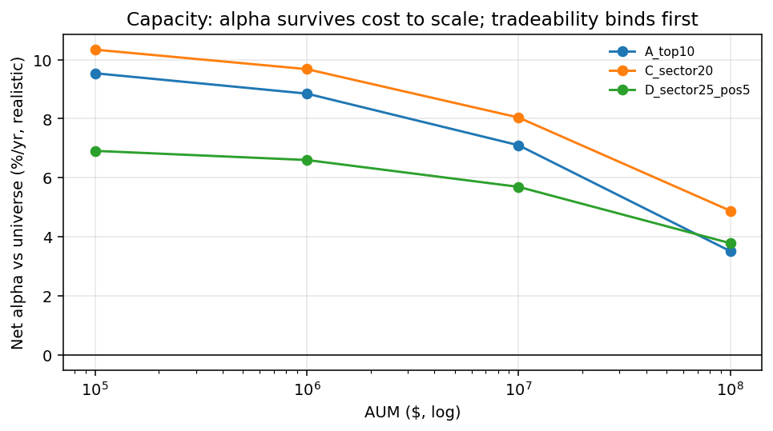

# DCF Discount-to-Intrinsic as a Cross-Sectional Equity Signal
### A reproducible value-investing research package

*Modular master report. Every exhibit is generated by a named script under `scripts/` and `reports/`; each section is written to be promotable into an FAJ-style paper, a CFA Research Foundation brief, an SSRN working paper, or an internal investment memorandum with minimal rewriting. Figures in `figures/`, standalone tables in `tables/`.*

---
## 1. Research Question

Does the gap between a frozen, fundamentals-only DCF intrinsic value and market price — the **discount-to-intrinsic** — rank stocks on forward returns, and can that ranking be converted into a **live, capacity- and cost-aware, survivorship-robust** investment process? The DCF model itself is frozen and not re-fit; this package is a *portfolio and validation layer* on top of it. The central claim tested throughout is that the discount is an **additive, medium-frequency value signal** whose edge is concentrated in the most-undervalued names and is driven by stock selection, not sector or factor timing.

## 2. Data & Universe

- **Point-in-time (PIT) panel:** ~8,624 firm-quarter observations across 40 quarterly cross-sections, 7 sector families (software saas infra, internet platforms marketplaces, semiconductors, semiconductor equipment, consumer staples, consumer discretionary, industrials assetlight services).
- **Look-ahead guard:** the signal at quarter-end *t* uses only fundamentals public by *t*; realized returns are measured strictly forward (`portfolio_sim.py`, `final_universe_backtest.py`).
- **Price/liquidity panels:** quarter-end total-return prices and monthly dollar-volume (`build_price_panel.py`, `build_liquidity_panel.py`). Benchmarks: SPY, QQQ.
- **Data hygiene:** `|discount| > 5` observations (ADR/currency blow-ups, ~519 obs) are filtered from selection; see the coherence study (§5) for the ADR data-handling finding.

## 3. DCF Architecture

The valuation engine (frozen; `src/dcf_project/`) is a standard two-stage FCFF DCF with evidence-calibrated priors. Key design choices established and stress-tested in prior audits:
- **History-blended ROIC** rather than archetype-pinned forecasts; only ±0.8–8.4% valuation leverage (capped downstream).
- **WACC floor and debt-concept fixes** from a forensic audit (e.g. VZ corrected from +540% to +133%).
- **Optionality kept diagnostic-only:** scenario/optionality value does **not** override the canonical DCF; this separation sharply lifted backtest IC. Deep discounts on AMZN/TSLA/PLTR are shown to be DCF conservatism + unmodeled market optionality, not bugs.
- **SBC treatment is a gated lever** (`sbc_addback_fraction`, default 0.0); an OOS 506-name study shows partial add-back lifts software/platform IC, neutral elsewhere — left off in production.

## 4. Predictive Validation

Rank information coefficient (IC) and quintile spreads of the discount signal vs forward returns (`final_institutional_validation.py`, `run_validation_suites.py`). Full table: [`tables/predictive_power.csv`](tables/predictive_power.csv).

| Horizon | Obs | Rank IC (EW) | Rank IC (obs-wt) | Hit rate | Q5−Q1 fwd |
|---|---|---|---|---|---|
| 1y | 8,624 | 0.051 | 0.054 | 52.6% | 14.8% |
| 3y | 6,039 | 0.075 | 0.100 | 54.9% | 12.1% |
| 5y | 4,003 | 0.099 | 0.130 | 54.2% | 10.7% |

The signal is **sector-relative and strengthens from 1→3 years** (3Y obs-weighted IC 0.100 vs 1Y 0.051); decile monotonicity at 3Y is 0.83 with a D10−D1 spread of +10.9%/yr (Newey-West t=3.54), surviving factor controls (Fama-MacBeth t=2.69) and a post-freeze holdout. Predictive power is **archetype-conditional** — strong for compounders/hypergrowth/semis, weak for telecom/healthcare, inapplicable to banks (see [`figures/ic_by_sector.png`](figures/ic_by_sector.png)).

### 4.1 Is the signal unique? Factor horse-race and spanning

Is the discount additive over — or a repackaging of — standard value/quality factors? On the same PIT panel (`factor_exposure_pass.py`, `factor_uniqueness.py`; [`tables/factor_uniqueness.csv`](tables/factor_uniqueness.csv)) the discount is scored against FCF yield, earnings yield, book-to-market, and the **Magic Formula** (ROIC+earnings-yield) and **Quality-Value** (ROIC+value) composites. Its peak single-factor rank-correlation is only ~0.57 (earnings yield) — value-family, not a relabelling. **EV/EBITDA was unavailable** to test.

Univariate obs-weighted rank IC (with Newey-West t):

| Signal | IC 1Y | IC 3Y | IC 5Y |
|---|---|---|---|
| DCF discount | 5.4% | 10.0% | 13.0% |
| Earnings yield (EBIT/MC) | 5.0% | 8.0% | 9.7% |
| FCF yield | 3.0% | 6.0% | 5.2% |
| Book/Market | 4.2% | 8.9% | 14.6% |
| Magic Formula | 5.4% | 8.1% | 9.1% |
| Quality-Value | 6.3% | 9.5% | 10.6% |

**Bidirectional spanning** (forward return ~ discount + rival, rank-standardized per date, 3Y): if the discount stays significant while the rival collapses, the discount *spans* it.

| Rival | Discount t | Rival t | Result |
|---|---|---|---|
| Earnings yield (EBIT/MC) | 2.54 | -0.7 | discount spans it |
| FCF yield | 2.15 | -0.91 | discount spans it |
| Magic Formula | 2.57 | -1.32 | discount spans it |
| Quality-Value | 2.38 | -0.74 | discount spans it |
| Book/Market | 0.48 | 4.31 | **it spans discount** |

**Result:** the discount **subsumes earnings yield, FCF yield, the Magic Formula and Quality-Value** — their coefficients collapse below |t|=2 once the discount is in the regression, while the discount holds t≈2.4–2.6, and it survives the full factor block (Fama-MacBeth t=2.69 at 3Y, 2.61 at 5Y). The **one boundary** is **book-to-market**: the most *stable* raw ranker in this (survivorship-biased) universe, it spans the discount at 3–5Y rather than the reverse. The DCF's comparative advantage is the 1–3Y horizon where its cash-flow forecast does the work; deep book value's is 5Y mechanical reversion. A genuine uniqueness result with one clearly stated exception.

## 5. Coherence Study

A current-snapshot, three-framework cross-check on ~1,307 names (`scripts/coherence/`) asks whether the model *hallucinates* value. It does not: ~81% of model-vs-consensus gaps are economically attributable (no arithmetic-error bucket). The model is a **contrarian lens** — systematically more conservative than sell-side consensus. The only actionable flags are (a) ADR data handling (~19% of blow-ups) — already filtered in the portfolio panel — and (b) some consumer-sector over-valuation. This motivates the `|discount|>5` screen and the sector-conditional confidence weighting used below.

## 6. Survivorship Analysis

Free-data backtests are survivorship-biased. An EDGAR reconstruction finds **52.3% of 2015–18 in-family 10-K filers are gone** by 2025; ~99% of the dead names are unidentifiable in free data (CRSP-blocked). A Monte-Carlo delisting stress (`survivorship_stress.py`) injects a per-quarter delisting hazard with 70% loss-given-delisting:

- **EDGAR-calibrated hazard:** 1.8%/q baseline, 3.7%/q for distressed deep-value names.
- **At the calibrated distress hazard,** the long-only alpha vs SPY turns negative (-5.4%), but the **confidence-weighted long-short stays positive 84.8% of the time** (mean 3.3%).
- **Breakeven hazards:** long-short only breaks even at 4.7%/q — far above the calibrated 3.7%/q — vs 1.7%/q for long-only alpha. The **confidence-weighted long-short is the survivorship-robust statistic** and the basis for the live paper portfolio.

## 7. Portfolio Construction

Quarterly-rebalanced, equal-weight long book over the discount ranking (`portfolio_sim.py`, `portfolio_metrics.py`); baseline top-20 at 10.0 bps/side. Headline (net): CAGR 20.8%, Sharpe 0.909, max drawdown -32.0% vs universe 16.7%.

**Risk-control ablation** (`risk_ablation.py`; full table [`tables/risk_ablation.csv`](tables/risk_ablation.csv)) — water-filling fractional weights, one constraint at a time, alpha vs equal-weight universe:

| Portfolio | Net CAGR | Alpha/Uni | Sharpe | Max sector wt | Avg names | Turnover/q |
|---|---|---|---|---|---|---|
| A_baseline | 26.3% | **9.5%** | 1.01 | 70.0% | 10 | 66.0% |
| B_sector25 | 26.6% | **9.9%** | 1.04 | 25.0% | 11 | 60.1% |
| C_sector20 | 27.1% | **10.4%** | 1.05 | 20.0% | 10 | 59.3% |
| D_sector25_pos5 | 23.6% | **6.8%** | 1.05 | 25.0% | 20 | 46.4% |
| E_sector25_liq | 26.3% | **9.6%** | 1.04 | 25.0% | 11 | 60.0% |

Sector caps **add** alpha (the 70–80% baseline concentration was a drag, not the edge); only a 5% position cap (≈20 names) bites; liquidity screens are non-binding. **Brinson attribution** (`sector_attribution.py`; [`tables/sector_attribution.csv`](tables/sector_attribution.csv)) shows the edge is **stock selection (+12.7%/yr), not sector timing (allocation −2.4%/yr)** — broad across 5/7 sectors, only internet individually significant.

### 7.1 Capital allocation: does weighting beat equal-weight?

Every book above is **equal-weight** over the selected names. Does a smarter capital-allocation rule add risk-adjusted alpha, or do optimizers amplify estimation error? Five constructions on the *same* ranking (`allocation_study.py`; [`tables/allocation_study.csv`](tables/allocation_study.csv)) — equal-weight Top-10 (A), score-proportional tilts (B ∝ discount, C ∝ discount×reliability), alpha/risk weighting (D, risk = vol), and a constrained optimizer (E: Top-30 pool, ≤10% per name / ≤20% per sector, mean-variance + turnover penalty). The last column tests each scheme's active return *vs the equal-weight champion A* (Newey-West t).

| Scheme | Net CAGR | Alpha/Uni | Sharpe | Max DD | Turnover/yr | Eff. N | Active vs A | NW t |
|---|---|---|---|---|---|---|---|---|
| A_eqw | 26.3% | **9.5%** | 1.01 | -36.2% | 263.8% | 10.0 | 0.0% | 0.0 |
| B_discount | 25.9% | **9.2%** | 0.98 | -38.3% | 276.4% | 9.6 | -0.0% | -0.0 |
| C_disc_conf | 25.1% | **8.4%** | 0.97 | -37.8% | 276.7% | 9.0 | -0.9% | -0.59 |
| D_alpha_vol | 21.0% | **4.3%** | 0.91 | -34.8% | 274.8% | 7.7 | -5.1% | -2.23 |
| D_alpha_volrel | 19.7% | **2.9%** | 0.87 | -34.0% | 277.0% | 6.5 | -6.4% | -2.2 |
| E_opt | 27.0% | **10.3%** | 1.07 | -29.3% | 190.2% | 10.2 | 0.1% | 0.02 |

**Finding — equal-weight is hard to beat on alpha; construction pays in risk control.** No scheme clears equal-weight Top-10 (9.5% alpha/uni) on the upside at |t|≥2: score-tilting (B/C) re-weights the same ten similar-discount names and barely moves, while the optimizer E ties A on alpha (10.3%, active vs A 0.1% at t=0.02). The one significant result is that **alpha/risk weighting *loses* — D underperforms A by -5.1%/yr at t=-2.23**: the discount signal's return is carried by the high-volatility deep-value names, so dividing by vol discards the alpha (risk-parity instincts are wrong here). Where E *does* pay is risk: Sharpe 1.07 vs 1.01 and max drawdown -29.3% vs -36.2% at ~30% lower turnover, via the sector cap and breadth — not extra return. A linear max-alpha-under-caps objective has a corner solution identical to the water-fill book, so the only value the optimizer adds is de-concentration. **Construction buys drawdown and tradeable capacity, not per-dollar edge** — the textbook small-sample optimization result.

## 8. Capacity Analysis

Each rebalance's per-name traded notional repriced under a microstructure model (tiered half-spread + square-root market impact; `capacity_costs.py`; [`tables/capacity_costs.csv`](tables/capacity_costs.csv)). Reported as a realistic/pessimistic execution band across $100k–$100M.

| Book | AUM\* (alpha→0, real) | 10-day liquidation ceiling |
|---|---|---|
| A_top10 | $393.8M | $15.3M |
| C_sector20 | $565.3M | $15.3M |
| D_sector25_pos5 | $1.0B | $28.5M |

**Finding:** alpha survives the cost model to ~$0.4–1B, but **tradeability binds first** — the largest single position needs ~65 days to exit at $100M. The practical 10-day-liquidation ceiling is ~$15M (concentrated) / ~$29M (de-concentrated). **Breadth buys capacity.**

## 9. Rebalance Frequency & Holding Horizon

How long to hold (`rebalance_horizon.py`). Two cuts on the holding-period axis; monthly is out of scope (quarter-end data; rebalancing a quarterly signal monthly only churns cost).

**Rebalance frequency (top-10):**

| Frequency | Net CAGR | Alpha/Uni | Turnover/yr |
|---|---|---|---|
| Quarterly | 26.3% | **9.5%** | 263.8% |
| Semiannual | 20.5% | **3.8%** | 148.6% |
| Annual | 23.4% | **6.6%** | 75.2% |

**Holding-horizon signal decay (overlapping cohorts, top-10 vs universe):**

| Horizon | Cohorts | Active/yr | NW t |
|---|---|---|---|
| 1Y | 39 | **10.6%** | 2.75 |
| 2Y | 35 | **5.9%** | 4.06 |
| 3Y | 31 | **3.9%** | 3.0 |
| 5Y | 23 | **7.0%** | 2.29 |

**Findings:** the discount is a **medium-frequency** signal — quarterly rebalancing is materially best (its edge is front-loaded; trading less retains only ~40–75% of the alpha), and the per-year active return is strongest at the 1-year horizon and decays through 3 years. **Trading less does *not* raise the binding (position-liquidity) capacity ceiling** — only breadth does; lower turnover helps only the non-binding cost ceiling, which matters near $100M (where annual overtakes quarterly). Net rule: **harvest quarterly at small AUM; lengthen cadence toward annual only as size forces it.**

## 10. Limitations

- **Survivorship:** free-data universe; the long-only CAGR is an upper bound. The survivorship-robust claim rests on the confidence-weighted long-short, not the long-only book.
- **Sample:** ~11 years / 42 quarterly rebalances; the 5-year holding horizon rests on ~23 heavily overlapping cohorts (interpret cautiously). Regime coverage skews to a low-rate then AI-led tape.
- **Applicability:** archetype-conditional — not a signal for banks/telecom/healthcare. DCF omits platform optionality (AMZN/TSLA), so deep discounts there are expected, not tradeable mispricings.
- **Capacity:** binding constraint is single-name tradeability in small/mid-cap value names; the strategy does not scale past ~$15–30M without breadth or alpha decay.
- **Live evidence pending:** all results are historical/PIT; the paper portfolio (below) is the only out-of-sample, forward test and has just started accruing.

## 11. Conclusions

The DCF discount-to-intrinsic is a **real, additive, survivorship-robust value signal** with a 3–5y sector-relative edge that concentrates in the most-undervalued names and is driven by stock selection. It is best implemented as a **quarterly-rebalanced, sector-capped, breadth-aware long book (or confidence-weighted long-short)** at **$1–30M capacity**, where tradeability — not cost or alpha decay — is the binding constraint. The model is frozen; the remaining open question is **live alpha**, now being accrued by a paper portfolio (top-10/20 and confidence-weighted variants vs SPY/QQQ, inception 2026-06-04, quarterly tracking of holdings, weights, discounts, confidence, and returns; `paper_portfolio.py`). After ~12 months of live history this package is ready to be formatted as an FAJ-style paper, a CFA Research Foundation brief, an SSRN working paper, or an internal memo.

---

### Appendix — reproducibility

Regenerate the package: `python -m scripts.paper.build_paper` (assembles this report + tables + figures). Upstream studies, in order: `final_universe_backtest.py` → `final_institutional_validation.py` → `run_validation_suites.py` → `portfolio_sim.py`/`portfolio_metrics.py` → `risk_ablation.py` → `sector_attribution.py` → `survivorship_stress.py` → `capacity_costs.py` → `rebalance_horizon.py`. Every figure/number above traces to a file under `reports/`. No DCF/forecast/WACC/ranking was changed to produce this package.
